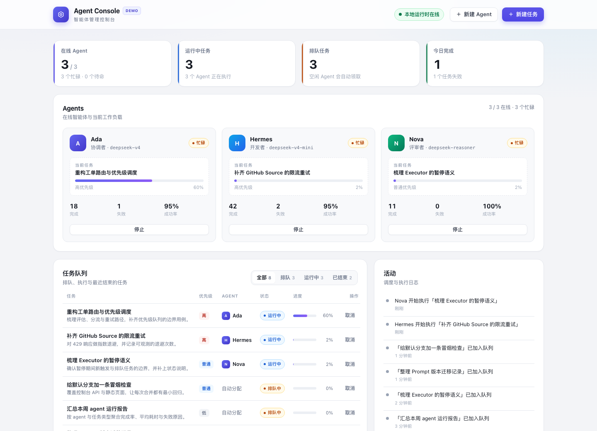

# dsh-superagent-demo

A playground repository for [dsh-superagent](https://github.com/deepseek-ai/dsh-superagent-prototype).

It now includes **Agent Console**, a self-contained agent management console for a small
simulated team. Open one page to see who is online, hand out tasks, follow progress, and read
the activity log. Everything runs locally with no external services and no npm dependencies.



## What it does

- **Agents** — create, start, stop and remove simulated agents. Each card shows its role, model,
  current task, progress and success rate.
- **Task queue** — create tasks with a priority and an optional target agent, filter by state,
  cancel work, and retry failed or cancelled tasks.
- **Activity log** — a running timeline of dispatch and execution events.
- **Local persistence** — state is stored in `data/state.json` and survives restarts.
- **Simulated runtime** — a one-second tick advances running tasks, lets idle agents claim
  queued work, and occasionally fails a task. No model API is called.

The console is a demonstration of the workflow, not a production scheduler: agent identities and
task execution are local simulations.

## Run it

Requires Node.js 20 or newer.

```bash
npm start
```

Open <http://127.0.0.1:4173>. The first launch seeds a small team, a running task and a queue, so
the page is useful immediately. Delete `data/state.json` (or the whole `data/` directory) to
reseed.

Environment variables:

| Variable | Default | Purpose |
| --- | --- | --- |
| `PORT` | `4173` | HTTP port |
| `HOST` | `127.0.0.1` | Bind address |
| `AGENT_CONSOLE_DATA` | `data/state.json` | State file location |

## API

The browser talks to a small JSON API. Every response is `{ "ok": true, "data": … }` on success
or `{ "ok": false, "error": { "code", "message" } }` on failure.

| Method | Path | Purpose |
| --- | --- | --- |
| `GET` | `/api/overview` | Agents, tasks, activity and summary counts |
| `POST` | `/api/agents` | Create an agent (`name`, `role`, `model`) |
| `POST` | `/api/agents/:id/start` | Bring an offline agent online |
| `POST` | `/api/agents/:id/stop` | Stop an agent; its running task is requeued |
| `DELETE` | `/api/agents/:id` | Remove an idle agent |
| `POST` | `/api/tasks` | Queue a task (`title`, `description`, `priority`, `agentId`) |
| `POST` | `/api/tasks/:id/cancel` | Cancel a queued or running task |
| `POST` | `/api/tasks/:id/retry` | Requeue a failed or cancelled task |

## Test

```bash
npm test
```

The suite uses the built-in `node:test` runner. It covers seed data, agent lifecycle, the
dispatch/execution tick, failure and retry paths, JSON persistence, the HTTP API, request
validation, and static asset serving.

## Project layout

```
server/
  index.js      HTTP server, JSON API and static assets
  store.js      Domain state, persistence and the simulated runtime tick
public/
  index.html    Console shell
  styles.css    Design tokens and layout
  app.js        Rendering, polling and dialogs
test/
  api.test.js   HTTP endpoint and static asset tests
  store.test.js Domain and simulation tests
docs/
  screenshots/  Visual evidence used in the pull request
```

## Ask the agent for work

This repository is also a place to try dsh-superagent. Comment on an Issue:

```
@firebook-agent <what you want>
```

A Ticket then appears on the superagent overview within about a minute.
